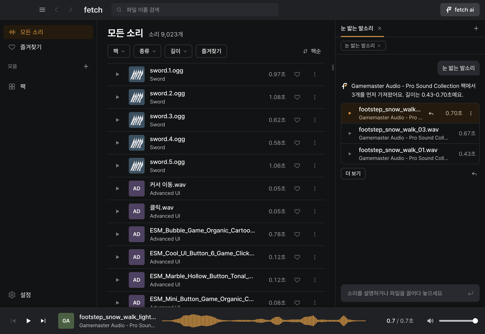

# fetch

게임 사운드 디자이너가 라이브러리를 다 듣지 않아도 원하는 사운드를 찾게 해 주는 대화형 사운드 큐레이션 AI입니다.

## 왜 만들었는가

사운드 디자이너가 가진 사운드는 너무 많아서 다 기억할 수도, 다 들어 볼 수도 없습니다. 기억하는 사운드만 쓰면 결과가 뻔해지고, 다른 사운드를 찾으려면 사실상 라이브러리를 전부 들어 봐야 합니다. 파일과 폴더가 잘 정리되어 있어도 어떤 사운드인지는 들어 봐야 알고, 정리가 안 된 사운드는 전부 들어 보는 수밖에 없습니다. 그래서 결국 사용하던 사운드만 쓰거나 일이 크게 늘어납니다.

fetch는 듣는 일을 AI가 대신합니다. AI가 라이브러리 전체의 사운드를 미리 분석해 두고, 사람은 원하는 사운드를 알려 준 뒤 추천 후보만 듣고 고릅니다.

## 핵심 기능

원하는 사운드는 세 가지 방법으로 AI에게 알려 줍니다.

- 말로 설명합니다. "눈 밟는 발소리"처럼 쓰면 AI가 설명과 라이브러리 전체의 사운드를 비교해 후보 3개를 먼저 보여 줍니다. 파일 이름이나 폴더 위치를 몰라도 됩니다.
- 말로 설명하기 어려우면 사용하던 사운드를 입력창에 끌어다 놓고 Enter를 누릅니다. 넣은 사운드의 팩은 뒤로 미루고 다른 팩의 비슷한 사운드를 먼저 보여 줍니다.
- 후보가 마음에 안 들면 바꾸고 싶은 점만 답장합니다. "문 닫히는 소리"에 철문이 나왔을 때 "오래된 나무 문 느낌으로"라고 답장하면 앞의 요청을 이어받아 다시 찾습니다.

찾은 샘플은 Logic Pro 등 DAW 타임라인으로 바로 끌어다 놓습니다. 원본 파일은 옮기거나 이름을 바꾸지 않습니다.

## 빠른 시작

### 웹 체험판

설치 없이 브라우저에서 바로 쓰는 체험판입니다. 데스크톱 Chrome과 Edge에서 열리며, DAW로 끌어다 놓는 기능은 데스크톱 앱에서만 됩니다.

[웹 체험판 열기](https://gjc-server.tail65a507.ts.net)

1. 사운드 폴더를 브라우저 화면에 끌어다 놓습니다. 처음 한 번은 브라우저 안에서 쓸 AI 모델을 내려받습니다.
2. fetch ai 입력창에 찾을 사운드를 설명합니다.

라이브러리가 없거나 작다면 예시 사운드 팩을 내려받아 쓸 수 있습니다.

[예시 사운드 팩 다운로드](https://github.com/iamwoosunglee-boop/fetch/releases/latest/download/fetch-example-sounds.zip)

예시 사운드 137개는 재배포 조건을 확인한 팩(Kenney, OpenGameArt 등)에서 골랐습니다.

### 데스크톱 앱 (macOS, Apple Silicon)

DAW로 끌어다 놓기까지 하려면 데스크톱 앱을 씁니다. Windows와 Intel Mac에서는 웹 체험판을 씁니다.

1. [최신 릴리스](https://github.com/iamwoosunglee-boop/fetch/releases/latest)에서 앱을 내려받습니다. Apple 서명을 받지 않은 앱이라 처음 실행할 때 '시스템 설정 > 개인정보 보호 및 보안'에서 "그래도 열기"를 눌러야 합니다.
2. 사운드 폴더를 연결합니다.
3. 원하는 사운드를 말로 설명하거나, 사용하던 사운드를 입력창에 끌어다 놓고 Enter를 누릅니다.
4. 고른 샘플을 DAW 트랙으로 끌어다 놓습니다.

## 데모 영상

[데모 영상 보기](https://youtu.be/g9Ze1nM2bw4) (2분 16초)

## 데이터 보호

- 오디오 원본은 기기 밖으로 나가지 않고 기기 안에서만 분석합니다.
- 입력한 요청과, 답 문장을 쓰는 데 필요한 결과 정보(파일 이름, 팩 이름, 길이, 개수)는 서버를 거쳐 Anthropic API로 전달됩니다. 제작자 서버에는 저장하지 않습니다.

## 현재 한계

- AI가 판단하기 어려운 사운드는 사람이 직접 분류하고, 그 결과가 다음 판단에 쓰이도록 설계해 기능까지 만들었습니다. 하지만 조정할 시간이 부족했고, 사람의 분류 대신 파일 이름 분류로 시험한 21가지 방식이 기준을 넘지 못해 이번 버전에서는 뺐습니다. 분류 결과를 저장하는 구조는 남겨 두었으므로, 실제 사용자의 분류가 쌓이면 다시 시험할 수 있습니다.
- 파일 이름과 폴더 이름, 그리고 CLAP(사운드와 글을 같은 공간에 놓는 분석 모델)이 계산한 좌표를 함께 보고 사운드를 찾습니다. 두 신호를 섞는 비율은 결과를 직접 들어 보며 정했지만, 아직 더 다듬을 수 있습니다.
- 사운드 분석은 기기 안에서 도는 CLAP 모델로 합니다. 더 강한 모델로 바꾸면 성능이 올라갈 수 있습니다. 같은 영어 검색 시험에서 Microsoft CLAP 2023은 84%로, 지금 모델의 70%보다 높았습니다. 다만 앱 안에서 돌아가는지 확인하고 모든 사운드를 다시 분석해야 해서 이번에는 바꾸지 않았습니다. 요청을 해석하고 답을 쓰는 LLM(Claude Haiku)도 더 강한 모델로 바꿀 수 있습니다.
- 데모라서 챗봇은 제작자의 개인 Claude API로 호출하며, 쓰는 사람은 비용을 내지 않습니다. 대신 호출 수를 하루 전체 5,000회, IP당 시간당 120회로 제한합니다. 제품이 되면 사용자의 구독 계정을 연결하거나, 무료 모델이나 로컬 모델을 쓰는 방식으로 바꿀 수 있습니다.

## 관련 문서

- [아키텍처와 폴더 구조](docs/architecture.md)
- [파이프라인 설계](docs/pipeline.md)
