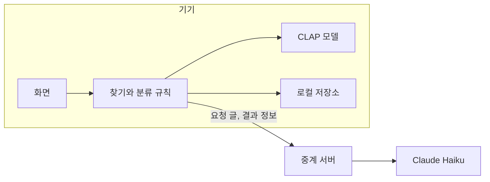

# 아키텍처 및 폴더 구조

fetch는 같은 화면 코드로 데스크톱 앱과 웹 체험판을 만듭니다. 사운드 분석은 기기 안에서 하고, 서버는 웹 페이지 제공과 Claude Haiku 호출 중계만 맡습니다.



| 구성 요소 | 데스크톱 앱 | 웹 체험판 |
|---|---|---|
| 실행 환경 | Electron | 데스크톱 Chrome, Edge |
| 화면 | Vite, TypeScript | 같은 코드 |
| 사운드 분석 | transformers.js, CLAP q8 모델 | 같은 모델을 브라우저에서 실행 |
| 폴더 읽기 | 파일 시스템 | File System Access API |
| 저장 | 앱 데이터 폴더 | IndexedDB |
| 사운드 넘기기 | DAW로 드래그 | 원본 파일 다운로드 |

서버로 가는 것은 요청 글과, 답 문장에 필요한 결과 정보(파일 이름, 팩 이름, 길이, 개수)뿐입니다. 사운드 원본은 보내지 않습니다. API 키는 서버에만 둡니다. 원본 파일은 읽기만 하고 이름이나 위치를 바꾸지 않습니다.

## 폴더 구조

```text
app/
  src/
    core/      찾기, 분류, 팩 구분, 모음, 파일 추적 규칙
    model/     CLAP 모델 실행
    renderer/  화면
    platform/  데스크톱 앱과 웹의 차이를 나누는 층
    main/      Electron 메인 프로세스, 폴더 훑기, 오디오 변환, 저장
    preload/   화면과 메인 프로세스 연결
  server/      Claude Haiku 중계 서버
  scripts/     시험과 검증 스크립트
```
