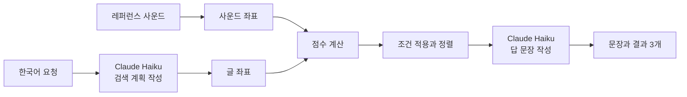

# 파이프라인 설계

## 폴더를 넣을 때

WAV, MP3, OGG, FLAC를 읽습니다. 분석 결과는 50개나 5초 단위로 묶어 저장합니다. 다시 열면 저장된 파일을 건너뛰고, 앱이 갑자기 꺼지면 마지막 묶음만 다시 분석합니다. 내용 지문으로 사운드를 알아보기 때문에 파일을 옮겨도 경로만 고칩니다. 사운드의 앞 10초만 분석하므로 긴 파일의 뒷부분은 찾지 못합니다.

## 사운드를 찾을 때

1. CLAP은 한국어를 거의 알아듣지 못합니다. Claude Haiku가 요청을 영어 검색 문장, 파일 이름 단어, 길이 조건으로 바꿉니다.
2. 앱이 라이브러리의 사운드 좌표와 비교해 점수를 냅니다. 말만 있으면 글 점수, 사운드만 있으면 사운드 점수, 둘 다 있으면 두 점수의 평균을 씁니다.
3. 레퍼런스 사운드가 있으면 그 사운드가 없는 팩을 먼저 보여 줍니다.
4. 같은 대화에서 이미 보여 준 사운드는 빼고 3개씩 보여 줍니다.
5. 앱의 점수는 맞을 확률이 아니므로 퍼센트로 표시하지 않습니다. 가까운 사운드가 없으면 찾았다고 말하지 않습니다.
6. 찾기가 끝나면 Claude Haiku가 결과 정보로 첫 문장을 쓰고, 서버가 결과의 길이를 알리는 둘째 문장을 붙입니다. 앱은 없는 파일, 틀린 숫자, 사운드 묘사가 있는지 검사합니다. 검사를 통과하지 못하거나 3초 안에 오지 않으면 앱이 준비한 문장을 씁니다. 결과는 문장이 나온 뒤에 보여 줍니다.

레퍼런스 사운드만 쓰거나 파일 이름으로 찾을 때는 Claude Haiku를 부르지 않습니다.

## 사운드를 넘길 때

데스크톱 앱은 WAV 파일을 원본 경로로 넘기고, 다른 형식은 WAV 사본을 만들어 넘깁니다. 웹 체험판은 원본 파일을 다운로드합니다.
